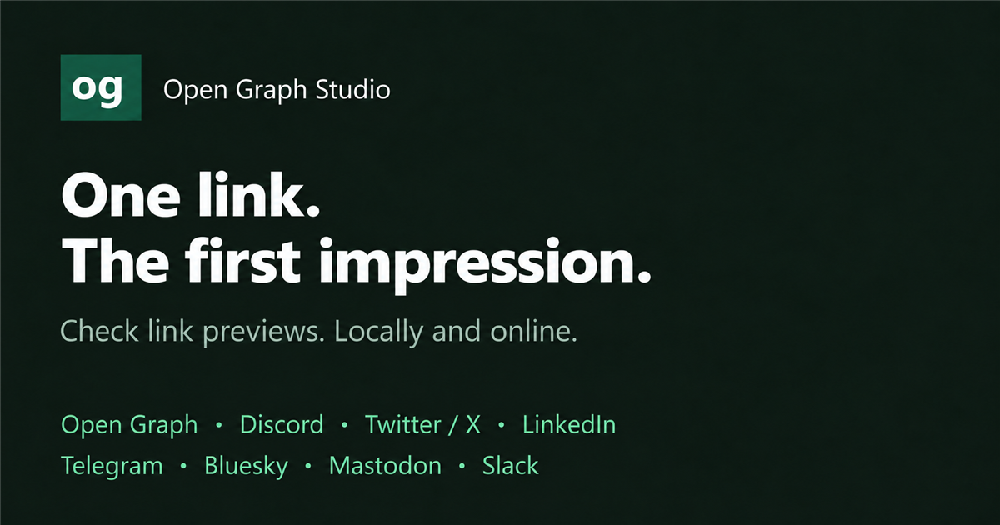

<div align="center">

# Open Graph Studio

**Check your links. Improve your previews. Share with confidence.**

A self-hosted Laravel tool for inspecting social metadata, preview images and Schema.org Product data — for public websites and local development.

[Live website](https://opengraph.works) · [Installation](#installation) · [Administration](#administration) · [Deployment](#deployment) · [License](LICENSE)



**Laravel 13** · **German & English** · **Light & Dark Mode** · **MIT License**

</div>

## What it does

Enter a URL, run a check and see how its metadata could appear across social platforms. Results explain missing fields, image issues and best-practice recommendations alongside the previews.

| Feature | Included |
| --- | --- |
| Social previews | Open Graph, Discord, Twitter/X, LinkedIn, Telegram, Bluesky, Mastodon, Slack and Microsoft Teams |
| Metadata checks | Open Graph properties, Twitter/X card tags and Schema.org Product data |
| Image checks | Image availability, dimensions and best-practice guidance |
| Sharing | Shareable checks and a bookmarklet to inspect the current page |
| Browser history | The last 20 URLs, stored only in the user's browser, with deletion and opt-out controls |
| Interface | German and English, light and dark themes, locally bundled FontAwesome |
| Instance management | Protected backend, authenticator 2FA, recovery codes and passkeys |
| Branding & legal pages | Custom logo, social image, favicon/app icons and separate German/English legal texts |
| Optional integrations | Matomo analytics, Sentry errors/logs/application metrics, Google and Bing verification |
| Search indexing | Sitemap, robots.txt, canonical URLs and language alternatives |

Previews are simulations based on the fetched metadata. Actual platform rendering can differ because of caching, crawler access and platform-specific behavior. The checker reads server-rendered HTML; it does not execute the target site's JavaScript.

## Installation

### Requirements

- **PHP 8.4.1+** for the current repository lock file, including development dependencies.
- **Composer 2**.
- PHP extensions: cURL, DOM, mbstring, GD, OpenSSL and PDO with a driver matching your database.
- SQLite, MariaDB/MySQL or PostgreSQL.
- A webserver serving the application's **`public/`** directory.

The Blade interface and bundled assets require **no frontend build**. Node.js is only needed to run the JavaScript tests.

> **PHP 8.3.6 deployments:** the separately built PHP 8.3 distribution uses its own Composer configuration and lock file. The repository's current lock file requires PHP 8.4.1+; changing only the declared PHP version will not make its dependencies compatible.

### 1. Get the project

```bash
git clone https://github.com/kuhla-tech/open-graph-preview.git
cd open-graph-preview
composer install
```

### 2. Configure the environment

Copy `.env.example` to `.env`, then set `APP_URL` to the actual origin of your instance. For example:

```dotenv
APP_NAME="Open Graph Studio"
APP_URL=https://og.test
```

Generate the application key:

```bash
php artisan key:generate
```

### 3. Configure the database

**SQLite:** enable `pdo_sqlite` and create an empty database file:

```bash
php -r "file_exists('database/database.sqlite') || touch('database/database.sqlite');"
```

Set `DB_CONNECTION=sqlite` in `.env`.

**MariaDB/MySQL:** create a database and configure its credentials:

```dotenv
DB_CONNECTION=mysql
DB_HOST=127.0.0.1
DB_PORT=3306
DB_DATABASE=opengraph
DB_USERNAME=your_user
DB_PASSWORD="your_password"
```

Enable `pdo_mysql` for both CLI PHP and the webserver/PHP-FPM. For PostgreSQL, use `DB_CONNECTION=pgsql` with the corresponding credentials and PDO driver.

Then create the tables:

```bash
php artisan config:clear
php artisan migrate --force
```

### 4. Create the first administrator

```bash
php artisan opengraph:admin --email=you@example.com --name="Your Name"
```

Open the one-use setup link printed by the command and choose a password. The link expires after **60 minutes**. There is no public registration.

For an expired link belonging to an account that has **never completed setup**:

```bash
php artisan opengraph:admin --email=you@example.com --renew-setup
```

### 5. Open your instance

Configure your webserver to serve `public/` at the origin defined by `APP_URL`. The existing root `.htaccess` supports the Laragon directory setup; production virtual hosts should point directly to `public/`.

Use HTTPS to enable passkeys. CLI and web requests must use the same `APP_URL` so signed setup links and passkey origins agree.

## Administration

Open **`<your-instance>/admin`** — locally, [https://og.test/admin](https://og.test/admin). Public pages deliberately contain no backend link.

| Section | Settings |
| --- | --- |
| General | Application name, default language, session lifetime, descriptions and example URL |
| Branding | Logo, Open Graph image, favicon/app icons, project owner and hosting credits |
| Search engines | Google/Bing verification tokens and Twitter/X account names |
| Monitoring & logs | Matomo, Sentry and application logging |
| Legal information | Operator, contact details, hosting location and declared retention periods |
| Legal text editor | Independent German and English imprint/privacy texts |
| Account security | Password, authenticator 2FA, recovery codes and passkeys |

Backend settings override `.env` defaults and are **encrypted in the database using `APP_KEY`**. Empty secret fields retain existing values; explicit removal controls clear them. Infrastructure such as the application key, origin, database connection and cache/session drivers stays in `.env`.

Sensitive changes require recent password or passkey confirmation. Passkeys require user verification and are bound to your instance's origin; changing domains requires registering new passkeys.

Brand uploads accept PNG, JPEG and WebP, up to 8 MB and 20 megapixels. Uploaded images are decoded and rewritten as PNG. Social images use 1200 × 630 pixels; app icons are generated automatically. Resetting custom assets restores the bundled defaults.

The legal editor accepts **plain text**, with HTML escaped. Empty fields use an instance-specific template. New installations do not inherit kuhla.tech's operator details; provide complete legal information and texts for your own deployment.

## Deployment

1. Install production dependencies with `composer install --no-dev --optimize-autoloader`, or upload a prepared distribution including `vendor/`.
2. Copy `.env.production.example` to `.env` for a new installation and configure the origin and database.
3. Set `APP_ENV=production`, `APP_DEBUG=false` and `PREVIEW_ALLOW_PRIVATE_TARGETS=false`.
4. Generate a key **only for a new installation**, run migrations and create your administrator.
5. Make `storage/` and `bootstrap/cache/` writable by the application.
6. Configure branding, legal information and optional integrations in the backend.

Validate and cache the configuration:

```bash
php artisan opengraph:check-production
php artisan optimize:clear
php artisan config:cache
php artisan route:cache
php artisan view:cache
```

**Updating an existing installation:** retain its `.env`, database, uploaded branding assets and original `APP_KEY`. Changing the key prevents decryption of stored settings and security data. Run `php artisan migrate --force` after deploying the updated code.

See [the hosting guide](docs/hosting.md) for additional operational details.

## Privacy & network access

- Checked URLs and fetched page content are not stored as server-side scan history.
- Optional history remains in the user's browser and can be disabled or deleted.
- Share links use a `#url=` fragment; the target is submitted to the checker in a POST body.
- Public deployments reject private/local addresses and non-80/443 ports, validate redirect destinations and pin verified IP addresses for requests.
- `PREVIEW_ALLOW_PRIVATE_TARGETS=true` is intended only for trusted local installations.

**Matomo** loads after consent and is configured without tracking cookies, browser-feature detection, referrer, query strings or checked URLs. Configure IP anonymization and actual data retention in Matomo itself.

**Sentry** receives sanitized errors, allowlisted logs and application metrics. Browser SDK, session replay, profiling and outgoing URL traces are disabled. Analytics does not run in the backend.

Configure reverse proxies, access logs and other infrastructure to avoid recording request bodies or sensitive query strings, including signed administrator setup links. Declaring retention periods in legal settings does not configure deletion in external services.

## Search engines

Add the HTML-tag verification tokens in the backend's Search engines section, then verify your public homepage in Google Search Console or Bing Webmaster Tools. Google domain properties use DNS verification instead.

Submit **`/sitemap.xml`** on your instance. It includes the public homepages and legal pages with their language variants. **`/robots.txt`** points to the sitemap.

## Development & contributions

Bug reports and pull requests are welcome. Include reproduction steps and remove credentials or private URLs from examples.

Run the relevant checks before submitting changes:

```bash
php artisan test
node --test tests/Feature/*.test.cjs
vendor/bin/pint --test
```

Never commit private `.env` files, databases, uploaded instance assets or administrator setup links.

## License & credits

Released under the [MIT License](LICENSE).

A project by [kuhla.tech](https://kuhla.tech). The hosted instance is available at [opengraph.works](https://opengraph.works).
